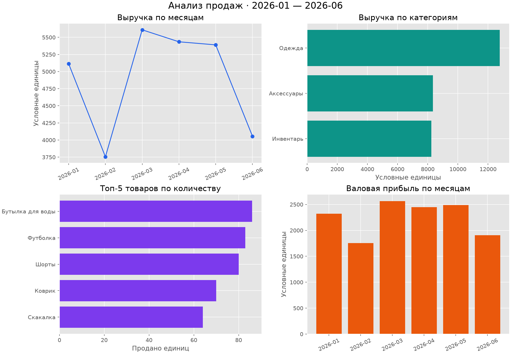

# Анализ продаж магазина на Python

Небольшой учебный проект по анализу данных: загрузка продаж из CSV, проверка качества данных, расчёт показателей и визуализация. Используются Python, pandas и Matplotlib.

## Что делает проект

- Проверяет пропуски, повторяющиеся номера заказов, даты, цены и количество.
- Рассчитывает выручку, себестоимость, валовую прибыль, средний чек и валовую рентабельность продаж.
- Группирует продажи по месяцам, категориям и товарам.
- Находит самые продаваемые товары и категории с наибольшей выручкой.
- Сохраняет таблицы CSV и четыре графика на одной картинке.



## Данные

`data/sales.csv` содержит **240 вымышленных заказов** за январь–июнь 2026 года: 9 товаров в 3 категориях. Данные созданы скриптом `generate_data.py` с фиксированным `seed=42`.

| Столбец | Значение |
| --- | --- |
| `order_id` | Уникальный номер заказа |
| `date` | Дата в формате `YYYY-MM-DD` |
| `category` | Категория товара |
| `product` | Название товара |
| `quantity` | Количество единиц |
| `unit_price` | Цена продажи одной единицы |
| `unit_cost` | Закупочная стоимость одной единицы |

## Запуск

Для первого запуска выполните в PowerShell из папки проекта:

```powershell
python -m venv .env
.\.env\Scripts\python.exe -m pip install -r requirements.txt
.\.env\Scripts\python.exe analyze.py
```

В `requirements.txt` указаны только две используемые внешние библиотеки: pandas и Matplotlib. 

Для анализа своего CSV с такими же столбцами измените `INPUT_FILE` в начале `analyze.py`:

```python
INPUT_FILE = ROOT / "data" / "my_sales.csv"
```

Папка результатов задаётся рядом через `OUTPUT_DIR`. После изменения запустите `analyze.py` обычной командой.

Чтобы заново создать исходные демонстрационные данные:

```powershell
.\.env\Scripts\python.exe generate_data.py
```

Последняя команда перезаписывает `data/sales.csv` теми же демонстрационными заказами.

## Результаты

После запуска появится папка `reports/`:

| Файл | Содержимое |
| --- | --- |
| `summary.csv` | Итоговые показатели за весь период |
| `monthly.csv` | Продажи и валовая прибыль по месяцам |
| `categories.csv` | Выручка и валовая прибыль по категориям |
| `products.csv` | Количество проданных единиц и выручка по товарам |
| `dashboard.png` | Графики для визуального сравнения |

Формулы:

```text
Выручка = Количество × Цена продажи
Себестоимость = Количество × Закупочная стоимость
Валовая прибыль = Выручка − Себестоимость
Средний чек = Общая выручка / Количество заказов
Валовая рентабельность продаж, % = Валовая прибыль / Выручка × 100
```

## Структура

```text
analyze.py                 # Проверка данных, расчёты, таблицы и графики
generate_data.py           # Создание демонстрационных данных
requirements.txt          # Версии зависимостей
data/sales.csv            # Исходный CSV
docs/dashboard.png        # Пример графиков
```
